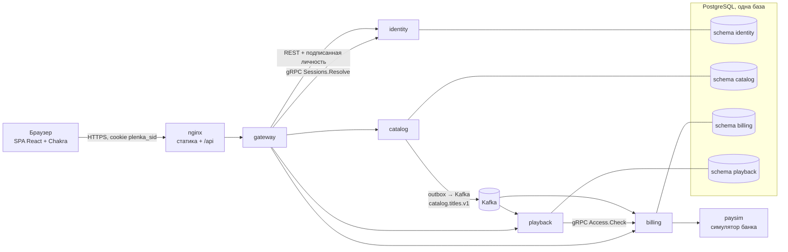
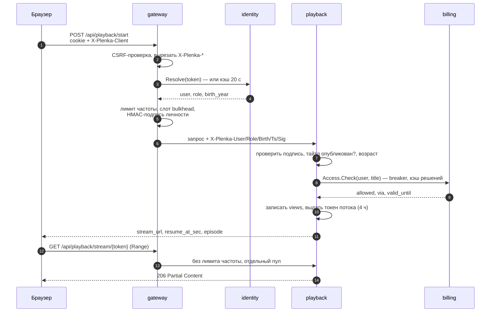
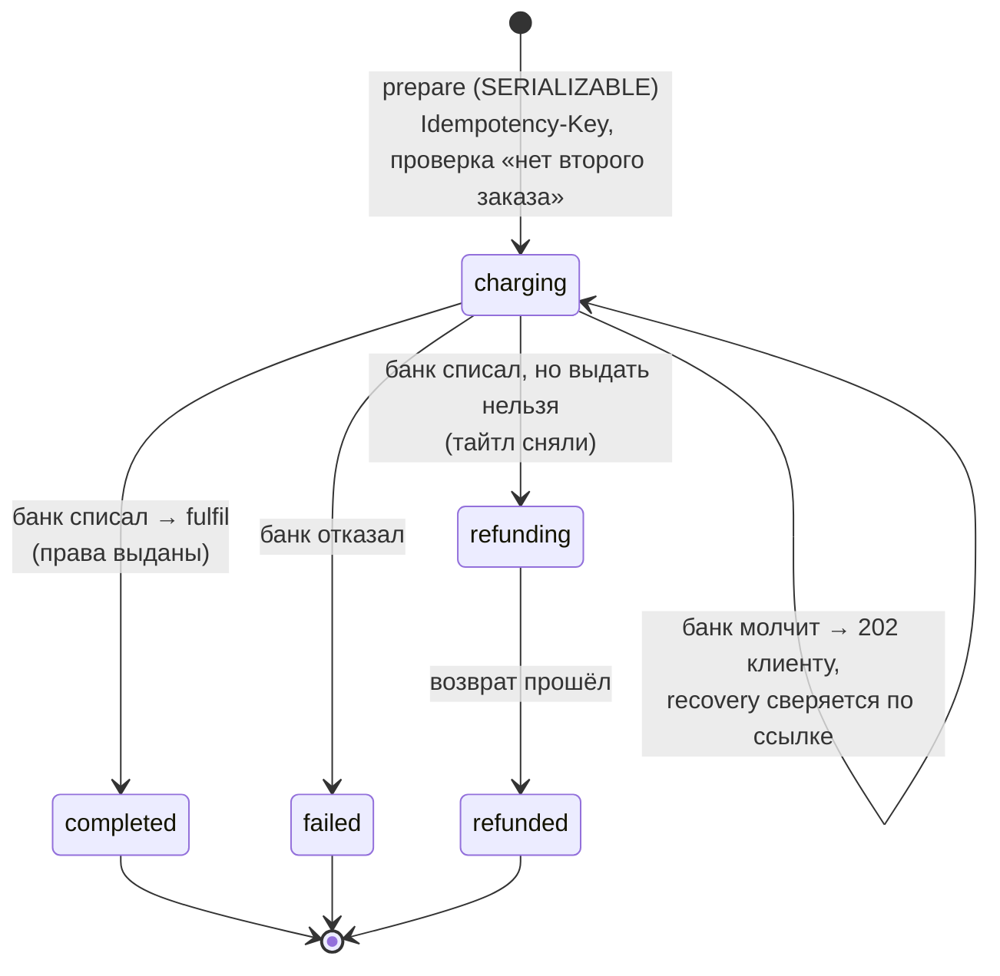
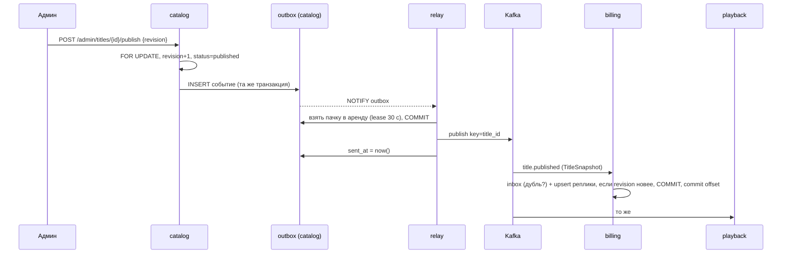

# Плёнка — архитектура

Онлайн-кинотеатр с двумя ролями. **Зритель** смотрит фильмы и сериалы по подписке или покупает фильмы навсегда, продолжает с места остановки, ведёт список «Смотреть позже», а в личном кабинете видит подписку, покупки, историю и устройства. **Администратор** заводит фильмы и сериалы с описанием и возрастным рейтингом, публикует их и снимает с показа, смотрит продажи.

## Контекст



| Сервис | Отвечает за | Хранит | Наружу | Внутрь |
|---|---|---|---|---|
| **gateway** | CSRF, сессия → подписанная личность, лимиты, bulkhead, маршрутизация | — (кэш сессий в памяти) | весь `/api` | gRPC → identity |
| **identity** | регистрация, вход, сессии, устройства, профиль | `accounts`, `sessions` | `/api/auth/*`, `/api/me*` | gRPC `Sessions.Resolve` |
| **catalog** | карточки, серии, жизненный цикл публикации, поиск | `titles`, `episodes`, `outbox` | `/api/titles*`, `/api/genres`, `/api/admin/titles*` | события `catalog.titles.v1` |
| **billing** | тарифы, оплата (сага), подписки, покупки, решение о доступе | `plans`, `orders`, `purchases`, `subscriptions`, `title_replica`, `inbox` | `/api/billing/*` | gRPC `Access.Check`, потребитель событий |
| **playback** | старт просмотра, поток, прогресс, история, «Смотреть позже» | `progress`, `views` (секции по месяцам), `watchlist`, `title_replica`, `inbox` | `/api/playback/*` | gRPC-клиент billing, потребитель событий |

## Путь запроса



## Оплата — оркестрируемая сага



- **prepare** — одна SERIALIZABLE-транзакция: проверить, что цель ещё не куплена и по ней нет незавершённого заказа, затем создать заказ `charging`. Повтор с тем же ключом возвращает существующий заказ.
- **charge** — вызов банка вне транзакции, с `context.WithoutCancel` и тайм-аутом `CHARGE_TIMEOUT`.
- **fulfil** — SERIALIZABLE: выдать покупку или продлить или создать подписку и перевести заказ в `completed`.
- **recover** — каждые 5 секунд: заказы в `charging` или `refunding` старше 10 секунд сверяются с банком и доводятся до конца.

## События



Контракт события — `contracts/events`: `Envelope{id, type, version, aggregate, revision, occurred_at, source, correlation, data}`. Данные — полный `TitleSnapshot`. Потребители обрабатывают только `title.*` и игнорируют неизвестные типы. Сообщение, которое нельзя обработать (ошибка `Permanent`), уходит в `catalog.titles.v1.dlq`.

## Данные

- **Одна база, четыре схемы, четыре роли.** Роль сервиса владеет своей схемой и не видит чужих (`deploy/init.sql`).
- **identity:** `accounts` (email `citext`, роль `viewer|admin`, ревизия), `sessions` (sha256 токена, скользящий и абсолютный срок, `revoked_at`).
- **catalog:** `titles` (CHECK: сериал не продаётся, у опубликованного есть доступ; генерируемый `tsvector`; частичные индексы под keyset-сортировки), `episodes` (уникальность сезон×серия).
- **billing:** `orders` (статусы саги, уникальный `(user_id, idem_key)`), `purchases` (PK `(user_id, title_id)`), `subscriptions` (частичный уникальный индекс «одна активная»), `paysim_charges`, `title_replica`, `inbox`.
- **playback:** `progress` (PK `(user_id, title_id)`, монотонный `client_ms`), `views` (RANGE по `started_at`, помесячно + DEFAULT), `watchlist`, RLS на всех трёх, `title_replica` с сериями в `jsonb`, `inbox`.

## Устройство сервиса

```
services/<svc>/
  cmd/main.go            конфигурация (env.Reader), сборка зависимостей, запуск
  migrations/*.sql       встроены в бинарник (embed), применяются при старте
  internal/core/         доменные правила: без БД, HTTP, gRPC, Kafka
  internal/usecase/      сценарии; интерфейсы хранилищ объявлены здесь
  internal/adapter/
    pgsql/               реализация хранилищ на pgx
    rest/                HTTP-обработчики (chi), DTO
    rpc/                 gRPC-сервер (identity, billing)
    access/, paysim/     клиенты соседей и внешних систем
  <svc>_test.go          интеграционные тесты на настоящем PostgreSQL
```

Общая инфраструктура — модуль `kit`: `env`, `problem` (RFC 7807), `principal` (подпись личности), `web`, `pgkit` (пул, миграции, SERIALIZABLE с повторами, RLS-контекст), `outbox`, `bus` (Kafka), `resil` (circuit breaker), `pgtest`. Контракты — модуль `contracts`: protobuf и Go-типы событий. `tools/archtest` проверяет, что сервисы не импортируют друг друга, а `core` не зависит от инфраструктуры.

## Фронтенд

```
frontend/src/
  core/        api (createApi, X-Plenka-Client), store, theme, problem, format, types
  ui/          Poster, TitleCard, состояния (Loading/Error/Empty), useFormErrors
  layout/      Shell: боковая навигация, поиск, меню пользователя, мобильный Drawer
  modules/
    catalog/   витрина (герой, «Продолжить», фильтры, бесконечная лента), поиск, карточка
    player/    плеер с пингами прогресса, «Смотреть позже»
    billing/   тарифы, окно оплаты (402/202/опрос/ключ идемпотентности)
    account/   вход, регистрация, кабинет (подписка, покупки, история, устройства, профиль), guards
    admin/     список тайтлов, редактор с сериями и публикацией, продажи
```

| Маршрут | Доступ | Страница |
|---|---|---|
| `/`, `/films`, `/series`, `/search` | все | витрина и поиск |
| `/title/:id` | все | карточка; действия зависят от роли и прав |
| `/plans` | все | тарифы (оплата — после входа) |
| `/login`, `/register` | гость | вход и регистрация |
| `/watch/:id?ep=` | зритель | плеер |
| `/watchlist`, `/cabinet?tab=` | зритель | «Смотреть позже», кабинет |
| `/admin/titles`, `/admin/titles/new`, `/admin/titles/:id`, `/admin/sales` | админ | админка |
| `*` | все | 404; 403 — внутри guard |

## Проверки

| Что | Где | Сколько |
|---|---|---|
| Интеграционные тесты на настоящем PostgreSQL: миграции под ролью-владельцем, код — под ролью данных (`TEST_PG_APP_DSN`), как в бою | `services/*/…_test.go`, `kit/outbox` | identity 3, catalog 5, billing 19, playback 20, outbox 2 — всего 49 (один, `TestNegativeDataRoleCannotDisableRLS`, требует `TEST_PG_APP_DSN`) |
| Изоляция ролей сервисов: чужие схемы закрыты владельцам и ролям данных, роль данных не меняет схему (`TEST_PG_ADMIN_DSN`) | `tools/isolation` | 1 |
| Потребитель на настоящей Kafka (`TEST_KAFKA_BROKERS`): poison pill → DLQ, ошибка данных → DLQ, временная ошибка без потери, падение после коммита → повтор, отсечённый inbox в PostgreSQL; смещения шести доставок одного события, то же смещение после сбоя, тайм-аут базы без DLQ | `kit/bus` | 7 |
| Модульные тесты без базы | `kit/principal`, `kit/resil`, `kit/bus` (классификация ошибок), `services/gateway/internal/edge`, `services/playback/internal/adapter/access` (гонка кэша) | 1 + 3 + 1 + 5 + 1 = 11 |
| Архитектура | `tools/archtest` | 1 |
| Сквозной сценарий через gateway | `scripts/e2e.py` | 33 проверки (в том числе возврат покупки и сброс кэша доступа событием) |
| Деградация при падении billing | `scripts/chaos.py` | 2 проверки (assert) |
| Нагрузка: p50/p95/p99, три повтора, 1/8/32 потока | `tools/loadgen`, результат — `docs/evidence/01-workload.md` | 2 сценария, 18 опытов |
| Фронтенд | `npm run check` (tsc strict, ESLint strict, Prettier) | — |

## Связь с курсом

| Тема | Где в Плёнке | Запись в TRADEOFFS |
|---|---|---|
| ПКП-1/2: гранулярность, силы интеграции и дезинтеграции | четыре сервиса и шлюз | 1.1–1.3 |
| ПКП-3/4: повторное использование кода, версионирование | `kit`, `contracts`, go.work | 7.3, 7.11, 7.12, 2.5, 4.16 |
| ПКП-5: ACID и BASE, паттерны согласованности, саги | локальные транзакции, реплики, сага оплаты | 3.1, 4.8, 4.15 |
| ПКП-6/7: DDD — контексты, агрегаты, объекты-значения | сервисы = контексты, «Заказ» — машина состояний | 1.14, 1.15 |
| ПКП-8: чистая архитектура | `core` / `usecase` / `adapter`, архитектурный тест | 7.2 |
| Владение данными (задания ч.1, кейсы 7–10) | схема и роль на сервис, разделение «тайтла» | 2.1, 2.18 |
| РХД ПР-1: нагрузка, инварианты, процентили | `tools/loadgen`, `docs/evidence/01-workload.md` | 3.11, 5.9 |
| РХД ПР-2: модель размещения, RLS, два уровня принуждения | `playback`: `FORCE ROW LEVEL SECURITY`, `set_config(…, true)`, роль данных без права снять RLS; `tenancy_test.go` (6 отрицательных, в том числе секции истории); `tools/isolation` | 2.19, 3.8, 3.9, 3.12 |
| РХД ПР-3: конкурентность | SERIALIZABLE с повторами, эксперимент READ COMMITTED; ревизия + `FOR UPDATE` в каталоге; условный upsert прогресса | 3.1–3.3, 3.7 |
| РХД ПР-4: outbox | catalog и billing; заказ, ответ и событие одной транзакцией; outbox billing закрыт правами и RLS; `docs/evidence/04-outbox.md` | 4.3, 4.4, 4.17 |
| РХД ПР-5: доставка через Kafka | проекция `order_feed` в playback (inbox + RLS под ролью данных), тайм-ауты, DLQ только для постоянных ошибок; сценарии повтора, падения после коммита, временной ошибки, poison pill — на настоящей Kafka | 4.5, 4.6, 4.18, 4.19, 2.6 |
