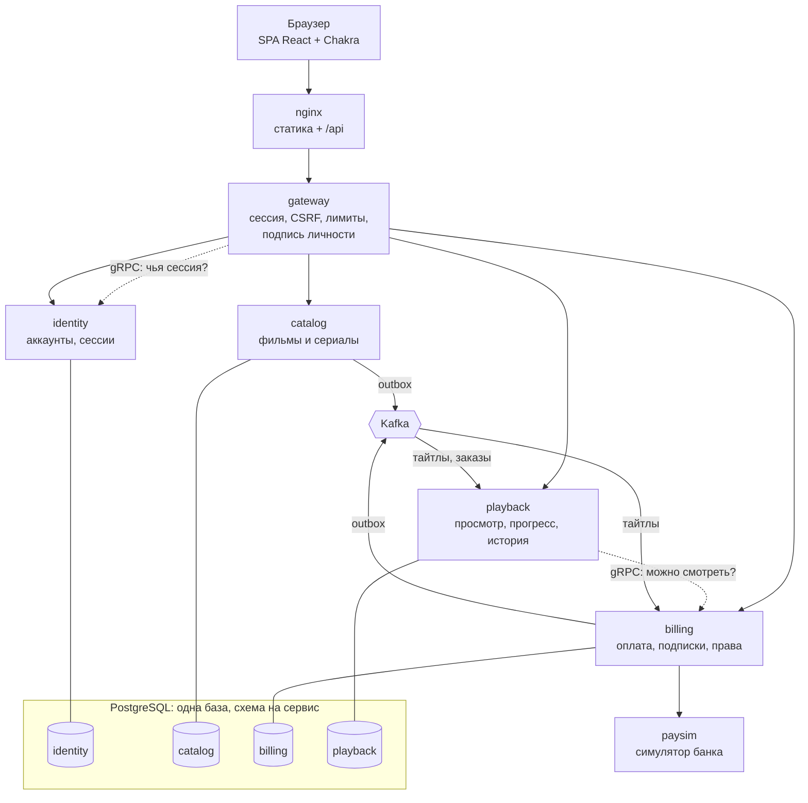
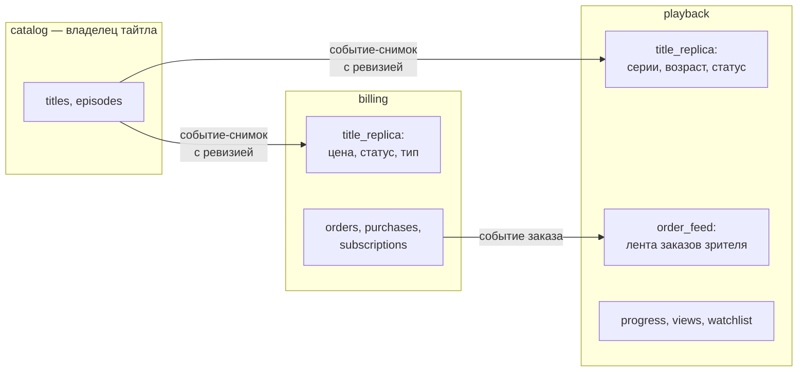
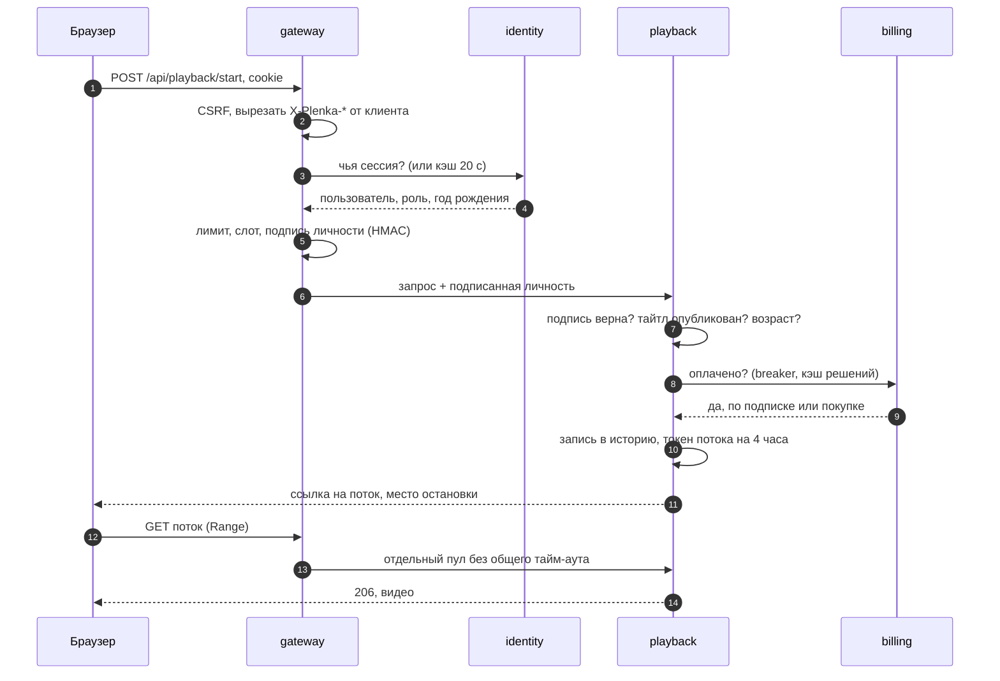
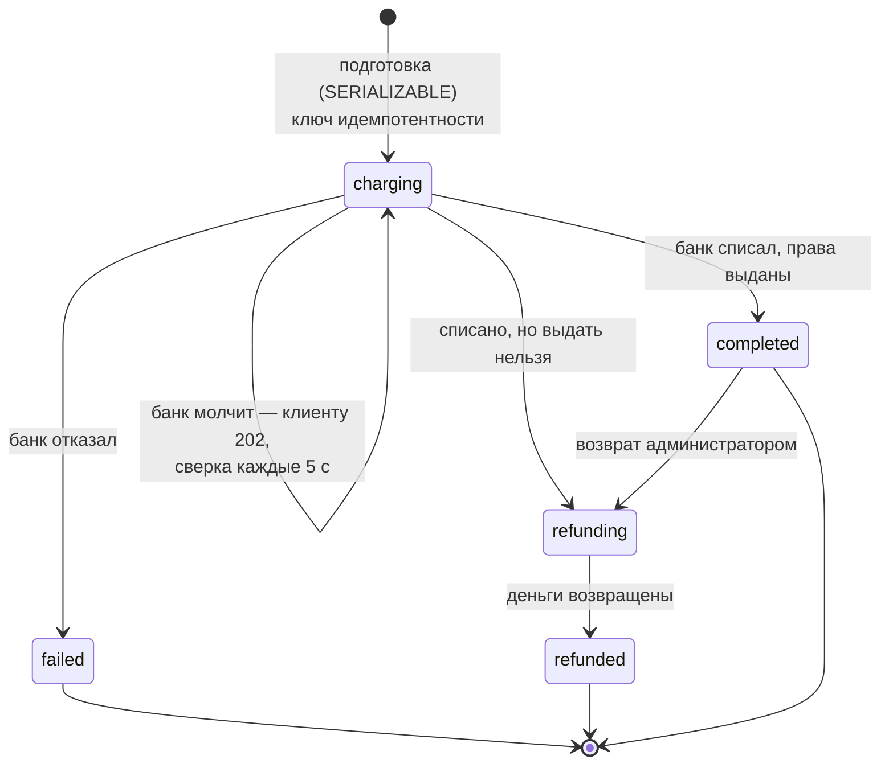
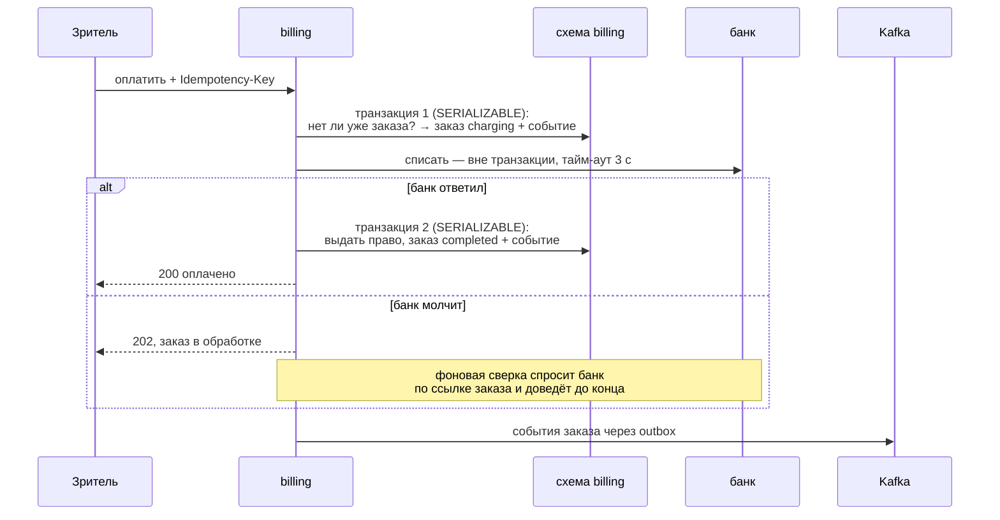
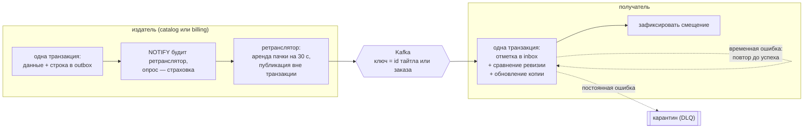
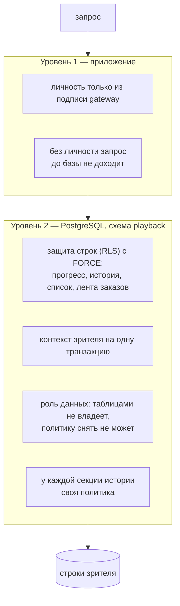
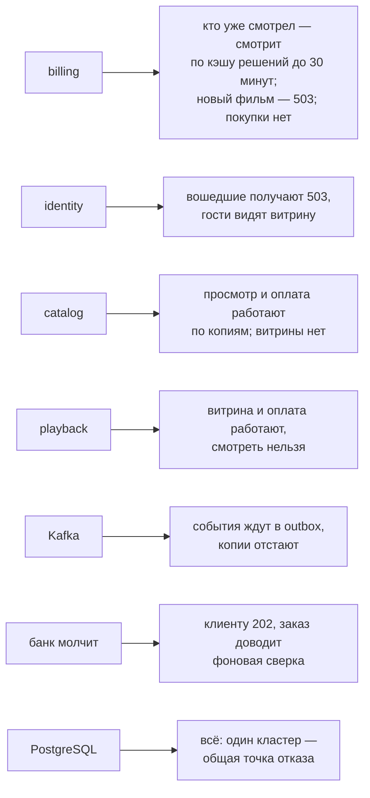

# Плёнка — как это устроено

Один документ, чтобы прочитать систему целиком: что это, из чего состоит, как идёт запрос, где что хранится, что происходит при отказах и чем заплачено за каждое решение.

Подробности лежат рядом и здесь не дублируются:

| Документ | Что в нём |
|---|---|
| [ARCHITECTURE.md](ARCHITECTURE.md) | схемы данных, маршруты SPA, связь с курсом, список проверок |
| [TRADEOFFS.md](TRADEOFFS.md) | 125 решений с ценой и условием пересмотра, 20 найденных дефектов |
| [evidence/01-workload.md](evidence/01-workload.md) | замер нагрузки и инварианты после него |
| [evidence/04-outbox.md](evidence/04-outbox.md) | проверка outbox |

Номера вида **3.1** — записи в TRADEOFFS.md (раздел.запись), **Д12** — дефекты там же.


## Словарь

Все термины документа. Читать подряд не обязательно: встретилось непонятное слово — оно здесь.

**Названия в этой системе**

| Слово | Что значит |
|---|---|
| identity | сервис входа: аккаунты, сессии, устройства |
| catalog | сервис каталога: карточки фильмов и сериалов, публикация, поиск |
| billing | сервис денег: оплата, подписки, покупки, решение «оплачено ли» |
| playback | сервис просмотра: старт, прогресс, история, «Смотреть позже» |
| paysim | программа-заглушка, изображающая банк |
| Тайтл | фильм или сериал в каталоге |
| Пинг прогресса | сообщение от плеера раз в 10 секунд: «зритель досмотрел до такой-то секунды» |
| JSON | текстовый формат данных, в котором сервисы обмениваются сообщениями |
| OpenTelemetry | стандартный набор инструментов для метрик и отслеживания запросов; здесь не подключён |

**Общее устройство**

| Слово | Что значит |
|---|---|
| Сервис, микросервис | отдельная программа со своей задачей. Система собрана из нескольких таких программ, которые общаются по сети |
| Монолит | противоположность: вся система — одна программа |
| Арендатор (tenant) | тот, чьи данные надо отделять от чужих. Данные разных арендаторов лежат рядом, но видеть друг друга не должны |
| Gateway, шлюз | программа на входе. Все запросы снаружи идут через неё: она проверяет, кто пришёл, и передаёт запрос нужному сервису |
| SPA | сайт, который загружается один раз и дальше сам подгружает данные, не перезагружая страницу |
| nginx | веб-сервер: раздаёт файлы сайта и пересылает запросы к шлюзу |
| REST, HTTP-запрос | обычный способ общения по сети: запрос «дай/создай/измени» и ответ с кодом |
| Коды ответа | `200`/`201` — успех (201 — создано новое), `202` — принято, ещё обрабатывается, `409` — конфликт (например, номеров нет), `429` — слишком много запросов, `401` — не вошёл, `503` — сервис сейчас недоступен |
| Синхронный вызов | один сервис спрашивает другой и ждёт ответа. Если второй лежит — первый тоже не может работать |
| Асинхронно | без ожидания: отправил сообщение и пошёл дальше, получатель обработает позже |
| Сессия, cookie | при входе сервер запоминает «этот браузер — такой-то пользователь» и выдаёт браузеру метку (cookie). Сессию можно отозвать мгновенно |
| JWT | альтернатива сессии: пропуск с подписью, который нельзя отозвать до конца срока |
| CSRF | атака: чужой сайт пытается отправить запрос от имени вошедшего пользователя. Шлюз от этого защищает |
| HMAC, подпись личности | шлюз подписывает секретным ключом «кто пришёл». Сервис проверяет подпись и не верит запросам в обход шлюза |
| gRPC | быстрый способ вызова между сервисами с жёстко описанным форматом (protobuf) |
| mTLS | взаимная проверка сертификатов между сервисами; здесь не используется |
| Range, код 206 | браузер просит кусок видео, а не весь файл |
| HLS, DRM, CDN | нарезка видео на куски, защита от копирования, сеть серверов раздачи. Здесь не сделано |
| `NOTIFY` | сигнал PostgreSQL «появилось новое», чтобы ретранслятор не ждал опроса |

**Данные и база**

| Слово | Что значит |
|---|---|
| PostgreSQL | база данных, в которой всё хранится |
| Схема базы | отдельный «раздел» внутри одной базы со своими таблицами и правами |
| Владение данными | правило: таблицу меняет только один сервис — её владелец |
| Реплика, копия | своя копия чужих данных. Сервис хранит у себя то, что ему нужно, чтобы не спрашивать владельца каждый раз |
| Событие-снимок | сообщение «вот текущее состояние объекта целиком», а не «вот что изменилось» |
| Версия, ревизия | номер, который растёт при каждом изменении объекта. По нему видно, какое сообщение новее |
| Согласованность в конечном счёте | копии догоняют оригинал не мгновенно, а через секунду-другую |
| Денормализация | хранить одно и то же в двух местах ради скорости (например, название отеля прямо в брони) |
| Индекс | «оглавление» таблицы, чтобы база находила строки быстро |
| Миграция | скрипт, который создаёт или меняет таблицы |
| Пул соединений | заранее открытые подключения к базе, которые запросы берут по очереди |
| Кэш | временная память: ответ запомнили, чтобы не спрашивать снова |
| Инвариант | правило, которое должно выполняться всегда. Например, «продано не больше, чем есть» |
| Секции (партиции таблицы) | большая таблица разбита на части по месяцам, чтобы старое легко убирать |

**Транзакции и одновременная работа**

| Слово | Что значит |
|---|---|
| Транзакция | несколько изменений, которые происходят все вместе или ни одно |
| COMMIT / откат | `COMMIT` — зафиксировать транзакцию; откат — отменить всё, что она успела сделать |
| Локальная транзакция | транзакция внутри одной базы. Надёжная и простая |
| Распределённая транзакция, 2PC | попытка сделать «всё или ничего» сразу в нескольких базах. Сложно и хрупко, поэтому её избегают |
| Гонка | два запроса одновременно делают одно и то же и мешают друг другу |
| Блокировка строки, `FOR UPDATE` | запрос «запирает» строку: остальные ждут, пока он закончит |
| `FOR SHARE` | мягкая блокировка: читать строку можно многим, менять — никому, пока читают |
| Взаимная блокировка (deadlock) | двое заперли по строке и каждый ждёт строку другого. Никто не двигается |
| Уровень изоляции | насколько строго база отделяет одновременные транзакции друг от друга |
| READ COMMITTED | обычный уровень: транзакция видит всё, что уже зафиксировали другие |
| SERIALIZABLE | самый строгий уровень: результат такой, будто транзакции шли строго по очереди. Если так не выходит, база отменяет одну из них, и её надо повторить |
| Оптимистичная запись, CAS | «запиши, только если с момента чтения ничего не поменялось». Не вышло — повтори |
| Ключ идемпотентности | случайный номер, который клиент прикладывает к запросу. Повтор с тем же номером не создаёт вторую бронь или оплату, а возвращает прежний ответ |
| Идемпотентный | такой, что повтор ничего не меняет |
| Перекос записи (write skew) | две транзакции прочитали «ничего нет», каждая решила, что можно, и обе записали. По отдельности обе правы, вместе — нарушение |
| Ложный конфликт | SERIALIZABLE отменил транзакцию, хотя настоящего конфликта не было: база перестраховалась |
| Сверка | фоновый процесс, который находит зависшие заказы и доводит их до конца |

**Сообщения между сервисами**

| Слово | Что значит |
|---|---|
| Событие | сообщение «случилось то-то», которое сервис рассылает остальным |
| Kafka, брокер | программа-почта: принимает сообщения и хранит их, пока получатели не заберут |
| Тема (topic) | «почтовый ящик» в Kafka для одного вида сообщений |
| Раздел, партиция | часть темы. Внутри раздела сообщения идут строго по порядку |
| Смещение (offset) | закладка получателя: до какого сообщения он уже дочитал |
| Outbox | таблица «исходящие». Сообщение кладётся туда той же транзакцией, что и основное изменение, а в Kafka уходит потом |
| Ретранслятор | фоновый процесс, который забирает сообщения из outbox и отправляет в Kafka |
| Аренда | ретранслятор помечает сообщения «взял на 30 секунд». Упал — метка истечёт, и их возьмёт другой |
| Inbox | таблица «уже получено». По ней получатель узнаёт повторное сообщение и не обрабатывает его второй раз |
| «Не меньше одного раза» | гарантия доставки: сообщение точно дойдёт, но может прийти дважды |
| Конверт события | служебная обёртка сообщения: номер, тип, время, версия формата |
| DLQ, карантин | отдельная очередь для сообщений, которые невозможно обработать |
| Временная / постоянная ошибка | временная пройдёт сама (база недоступна), постоянная — нет (сообщение испорчено) |
| Хореография | сервисы не командуют друг другом: каждый реагирует на события сам |
| Оркестрация | один сервис ведёт процесс по шагам и говорит остальным, что делать |
| Сага | длинный процесс из нескольких шагов в разных системах. Если шаг не удался, предыдущие отменяются |
| Компенсация | действие, отменяющее уже сделанный шаг (вернуть деньги, отменить бронь) |

**Защита**

| Слово | Что значит |
|---|---|
| RLS, защита строк | правило внутри самой базы: «эту строку видит только её хозяин». Работает, даже если в программе забыли проверку |
| Политика | одно такое правило RLS |
| `FORCE` | настройка, при которой политика действует даже на владельца таблицы |
| Контекст | база должна знать, от чьего имени запрос. Сервис сообщает ей это в начале каждой транзакции |
| Роль базы | учётная запись в базе со своим набором прав |
| Владелец | роль, которой принадлежат таблицы; может менять и правила |
| Роль данных | роль, под которой идут запросы пользователей: читать и писать строки можно, менять правила — нельзя |
| Триггер | код внутри базы, который срабатывает сам при изменении таблицы |
| Аудит | журнал «кто, что и когда сделал». В него можно только добавлять |
| Прерыватель (circuit breaker) | если сервис не отвечает, запросы к нему перестают отправлять и сразу возвращают ошибку — чтобы не копить очередь |
| Лимит запросов | ограничение, сколько запросов можно сделать за минуту |

**Проверки и замеры**

| Слово | Что значит |
|---|---|
| p95, p99 | время, в которое укладываются 95 (99) запросов из 100. Показывает не среднее, а «почти худший» случай |
| Медиана | середина: половина замеров лучше, половина хуже |
| SLO, цель | обещанный показатель: например, «p95 брони меньше 100 мс» |
| мс | миллисекунда, тысячная доля секунды |
| Модульный тест | проверка одной функции отдельно от всего |
| Интеграционный тест | проверка кода вместе с настоящей базой или Kafka |
| Сквозной сценарий (e2e) | проверка всей системы целиком, как её видит пользователь |
| Архитектурный тест | проверка, что сервисы не используют код друг друга |
| Детектор гонок | инструмент Go, который ловит ошибки одновременного доступа к памяти |
| Отрицательный тест | проверка, что запрещённое действительно запрещено |

---

## 1. Что это

> **Простыми словами.** Онлайн-кинотеатр: зритель смотрит и платит, администратор ведёт каталог.

Онлайн-кинотеатр с двумя ролями.

- **Зритель** смотрит фильмы и сериалы по подписке или покупает фильм навсегда, продолжает с места остановки, ведёт «Смотреть позже», в кабинете видит подписку, покупки, историю и устройства.
- **Администратор** заводит тайтлы, публикует и снимает их, видит продажи и может вернуть деньги за заказ.

Два правила, вокруг которых всё выстроено: **не списать деньги дважды** и **не показать неоплаченное**.

---

## 2. Карта системы

> **Простыми словами.** Система — это привратник на входе и четыре программы: вход и аккаунты, каталог фильмов, деньги, просмотр. Пунктир на схеме — места, где одна программа ждёт ответа другой; таких мест всего два.



| Сервис | Отвечает за | Хранит |
|---|---|---|
| gateway | сессия → подписанная личность, CSRF, лимиты, маршрутизация | ничего, кэш сессий в памяти |
| identity | регистрация, вход, сессии, устройства | аккаунты, сессии |
| catalog | карточки, серии, публикация, поиск | тайтлы, серии, outbox |
| billing | оплата, подписки, покупки, решение «оплачено ли» | заказы, покупки, подписки, outbox, копия тайтлов |
| playback | старт просмотра, поток, прогресс, история, «Смотреть позже» | прогресс, история, список, лента заказов, копия тайтлов |

**Почему границы именно такие** (1.1–1.3):

- playback **отдельно от catalog** — каталог правят несколько раз в день, а каждый смотрящий шлёт пинг раз в 10 секунд. Нагрузки несопоставимы;
- право смотреть решает **billing**, потому что оно следует из денег; возраст проверяет **playback**. У каждого вопроса один владелец;
- синхронных вызовов между сервисами **ровно два** (пунктир на схеме), всё остальное — событиями (4.2). Глубина цепочки — 1.

Кинотеатру на тысячу зрителей хватило бы монолита. Четыре сервиса — учебный эталон, и это записано первой строкой журнала (1.1).

---

## 3. Кто владеет данными

> **Простыми словами.** У каждой таблицы один хозяин. Фильм нужен трём программам, поэтому каталог рассылает его описание, а остальные хранят свои копии нужных полей.



Три правила:

1. **В таблицу пишет только её владелец.** База одна, но у каждого сервиса своя схема и свои роли; роль одного сервиса не читает схему другого. Это проверяет отдельный тест (2.1).
2. **«Тайтл» нужен трём сервисам — и общей таблицы нет.** Каталог публикует снимок при каждом изменении, billing и playback держат копии только нужных полей (2.4, 2.18).
3. **Копия принимает только более новую ревизию** — повтор и перестановка событий ничего не портят (2.6).

Цена: копии отстают на секунды — снятый с показа фильм ещё пару секунд стартует; общий кластер — общая точка отказа.

---

## 4. Путь запроса: старт просмотра

> **Простыми словами.** Зритель нажал «смотреть». Привратник узнаёт, кто это, сервис просмотра проверяет возраст и спрашивает у сервиса денег, оплачено ли. Потом отдаёт видео.



Что здесь важно:

- **Сессии серверные, не JWT** (6.1). Ради мгновенного отзыва и списка устройств. Цена — identity на пути каждого запроса; её снижает кэш на 20 секунд.
- **Личность дальше идёт подписанными заголовками** (6.5). Сервис, до которого достучались в обход gateway, отвергнет подделку. В подпись входят метод и путь — перехваченные заголовки не подставить в другой запрос (Д13).
- **Порядок проверок: сначала возраст, потом деньги** — чтобы подросток не видел предложение купить фильм 18+ (1.3).
- **Прогресс пишется без чтения и блокировок**: одна условная запись «только если пинг новее» (3.7).

---

## 5. Оплата

> **Простыми словами.** Оплата идёт в три шага: создать заказ, списать деньги в банке, выдать право смотреть. Если банк молчит, зрителю отвечают «обрабатывается», а фоновый процесс доводит заказ до конца.

Сага внутри billing: оркестратор — сам сервис, внешний участник — банк (4.8).





Что здесь важно:

- **Звонок в банк — вне транзакции** (4.9). Транзакция не ждёт сеть, а повтор сериализуемой транзакции не списывает деньги второй раз. Цена — состояние «возможно, списано, права не выданы»; его разбирает сверка (4.11).
- **Закрытая вкладка не обрывает списание** (4.12).
- **При возврате право исчезает раньше денег** (4.20). Худший случай — зритель без фильма ждёт возврат до 15 секунд, а не смотрит бесплатно.
- **Заказ, ответ команды и событие пишутся одной транзакцией** (4.17).

### Две вкладки и двойное списание

> **Простыми словами.** Зритель нажал «купить» в двух вкладках сразу. Без защиты получится два заказа и два списания. Самый строгий режим базы это ловит.

Зритель жмёт «купить» в двух вкладках. Обе транзакции видят «заказа нет», обе создают заказ. Это перекос записи: правило связывает несколько строк, и блокировать пока нечего (3.2).

| Уровень изоляции | Заказов | Списаний |
|---|---:|---:|
| READ COMMITTED | **2** | **2** |
| SERIALIZABLE с повтором **(выбрано)** | 1 | 1 |

Выбран SERIALIZABLE: база сама находит конфликт, даже когда транзакции читают разные строки (3.1). Цена оказалась неожиданной и нашлась замером: **ложные конфликты** (3.11, Д12). Проверка шла по общему индексу, разные зрители мешали друг другу, около 1 % покупок заканчивались ошибкой. После перехода на индекс по зрителю ошибок ноль, p95 упал со 108 до 18 мс.

---

## 6. Как события идут между сервисами

> **Простыми словами.** Сообщение о заказе записывается вместе с заказом, а отправляется потом. Оно может прийти дважды, но не потеряется; получатель узнаёт повторы.



| Сбой | Что происходит |
|---|---|
| Kafka недоступна | события копятся в outbox |
| Ретранслятор упал после публикации | аренда истекает, событие уйдёт повторно; inbox отсечёт дубль (4.3) |
| Получатель упал после коммита | то же смещение придёт снова, inbox его отсечёт |
| Событие с ревизией не новее сохранённой | ничего не меняет (2.6) |
| База получателя лежит | временная ошибка: повтор, раздел стоит, ничего не теряется (4.19) |
| Битое сообщение, негодный идентификатор | постоянная ошибка: в карантин |

Раньше корректное событие уходило в карантин после четырёх попыток, и минута простоя базы стоила потерянных событий (Д15). А событие с корректным JSON, но негодным идентификатором повторялось бесконечно и вешало раздел (Д18).

Три способа согласовать данные — где какой (4.15):

| Паттерн | Где | Почему |
|---|---|---|
| На основе событий | копии тайтлов, лента заказов | отставание в секунды допустимо, сервисы независимы |
| Оркестрация запроса | оплата | зритель ждёт ответа, согласованность важнее скорости: это деньги |
| Фоновая синхронизация | не применяется | внешний процесс писал бы в чужие таблицы. Сверка зависших заказов работает только с таблицами billing |

---

## 7. Как защищены данные зрителей

> **Простыми словами.** Историю и прогресс зрителя не увидит другой зритель. Проверок две: в программе и в самой базе.

Арендатор — зритель. Строки всех зрителей лежат в одних таблицах: отдельная схема на зрителя означала бы миллион схем (2.19).



Шесть отрицательных тестов идут прямым SQL мимо сервиса: чужое не читается; за другого не записать; без контекста — ноль строк; без личности запрос до базы не доходит; роль данных не снимает защиту; секции истории защиту не обходят.

Последний появился после находки (Д17): история разбита на секции по месяцам, а секция не наследует политику родительской таблицы. Прямой запрос к секции отдавал историю всех зрителей.

**Чего защита не закрывает:**

- **Подмену контекста.** Политика верит настройке, которую ставит код сервиса. Код, нарочно подставивший чужого зрителя, увидит его строки.
- **Владельца схемы.** Он может снять защиту; под ним идут миграции и обслуживание секций.
- **Заказы и права в billing** (3.13). Там защиты строк нет сознательно: главные читатели — сам сервис по всем зрителям сразу (сверка, проверка доступа, продажи). Изоляция — уровнем приложения. Номера карт не хранятся вовсе, только последние 4 цифры.

---

## 8. Что будет, если упадёт…

> **Простыми словами.** Что продолжает работать при поломке каждой части.



Два выбора здесь спорные, и они сделаны осознанно:

- **Новый фильм при упавшем billing — отказ** (5.4). Авария не превращается в бесплатный кинотеатр. Цена: новые просмотры в аварию невозможны.
- **Identity недоступен — 503, а не гость** (5.6). Вошедший не видит вдруг экран входа и не штурмует лежащий сервис. Цена: вошедшие не видят даже витрину.

Кэш решений — обмен денег на доступность: отменённая подписка может работать ещё до 5 минут, при аварии billing — до 30 (5.3). Возврат денег окно не ждёт: событие заказа сбрасывает кэш за секунды (4.18).

---

## 9. Цифры

> **Простыми словами.** Замер скорости под нагрузкой и пересчёт данных после него.

Замер идёт через gateway, а не голым SQL. Потоков 1, 8 и 32, по три повтора, итог по медиане. В базе 114 тысяч заказов, из них 100 тысяч залиты заранее.

| Операция (1 / 8 / 32 потока) | В секунду | p95, мс | p99, мс | Цель |
|---|---:|---:|---:|---|
| Пинг прогресса | 709 / 2 005 / 2 430 (весь сценарий) | 1.9 / 7.3 / 23.5 | 2.5 / 9.7 / 29.4 | выполнена |
| Лента «Продолжить» | — | 1.3 / 6.3 / 22.8 | 1.7 / 8.3 / 25.6 | выполнена |
| Покупка | 143 / 347 / 448 | 11.8 / 40.3 / 97.1 | 15.7 / 52.5 / 112.2 | выполнена до 8 потоков |

- **Узкое место — процессор стенда** (2 ядра, при 32 потоках занят на ~90 %). Больше всех берёт PostgreSQL, но gateway и playback вместе — больше него.
- **Покупка при 32 потоках цель не выполняет**, и это не скрыто: сериализуемые транзакции и два события на покупку стоят времени.
- **После опытов инварианты целы:** фильм не куплен дважды — 0 нарушений; покупок без завершённого заказа и заказов без списания — 0 и 0; зависших заказов — 0; неотправленных событий — 0 из 20 024.
- **Замер оптимистичен:** кэш прогрет, всё на одной машине, генератор сам ест процессор.

Проверки: 49 интеграционных тестов на настоящем PostgreSQL под ролью данных, 7 сценариев получателя на настоящей Kafka, 11 модульных, тест изоляции ролей, архитектурный тест; сквозной сценарий на 33 проверки и сценарий отказа billing.

---

## 10. Главные компромиссы

> **Простыми словами.** У каждого решения есть цена. Таблица: что выбрали, от чего отказались, что получили и чем заплатили.

| № | Решение | Вместо | Получили | Отдали | Передумать, если |
|---|---|---|---|---|---|
| 1.1 | Четыре сервиса и шлюз | Монолит | Границы по нагрузке и ответственности | Сеть, брокер, согласованность в конечном счёте | Проект станет реальным, а нагрузка останется маленькой |
| 1.6 | Снятый фильм недоступен даже купившим | Оставить купившим | Снятие — конец лицензии, одно правило | Спорно для зрителя; компенсация — возврат | — |
| 2.1 | Схема и роли на сервис в одной базе | Общая схема или четыре сервера | Изоляция средствами СУБД, один контейнер | Общая точка отказа | Сервисы начнут масштабироваться по-разному |
| 2.4 | Копии тайтлов событиями | Синхронный запрос в каталог | Просмотр и оплата не зависят от каталога | Отставание в секунды | Снятие должно действовать мгновенно |
| 2.19 | Общая модель и защита строк | Схема на зрителя | Одна схема на сервис | Ошибка политики открывает всё | Появятся корпоративные клиенты |
| 3.1 | Оплата на SERIALIZABLE с повторами | Блокировки на READ COMMITTED | База сама ловит перекос записи | Повторы, зависимость от планов запросов | Повторы станут заметны в p99 |
| 3.13 | Заказы в billing без защиты строк | RLS, как в playback | Служебные запросы по всем зрителям без обходов | Нет второй линии: забытый фильтр откроет чужие заказы | У зрителя появятся выборки с параметрами |
| 4.1 | Внутри gRPC, снаружи REST | REST везде | Типизированный контракт на двух вызовах | Два стека | — |
| 4.3 | Outbox с арендой | Блокировка на время публикации | Транзакция не ждёт брокер | «Не меньше одного раза», нужен inbox | Тысячи событий в секунду: читать журнал базы |
| 4.8 | Сага оплаты с оркестратором | Хореография | Виден шаг каждого заказа | Новый шаг — правка оркестратора | Шагов станет больше трёх |
| 4.10 | Медленный банк — 202 и опрос | Держать запрос | Соединения не копятся | Вторая ветка логики у клиента | Медленный банк станет нормой |
| 4.19 | Повтор временной ошибки без предела | Карантин после N попыток | Корректное событие не теряется | Раздел стоит, пока ошибка не пройдёт | — |
| 5.3 | Кэш решений доступа | Каждый раз спрашивать billing | Просмотр переживает аварию billing | Отменённая подписка работает до 5–30 минут | — |
| 5.4 | Нет решения и нет billing — отказ | Пустить | Авария не даёт бесплатный просмотр | Новые просмотры в аварию невозможны | — |
| 6.1 | Серверные сессии | JWT | Мгновенный отзыв, список устройств | identity на пути каждого запроса | — |
| 6.5 | Подписанная личность в заголовках | mTLS или доверие заголовкам | Подделка в обход gateway отвергается | Общий ключ у всех сервисов | — |

Остальные решения — в [TRADEOFFS.md](TRADEOFFS.md), по девяти разделам.

---

## 11. Чего сознательно нет

> **Простыми словами.** Что не делали и с чего начать, если понадобится.

| Чего нет | Что сделать первым |
|---|---|
| HLS, DRM, CDN | упаковка в HLS, подписанные ссылки |
| Настоящий платёжный провайдер | заменить симулятор адаптером, интерфейс уже есть |
| Автоматическое продление подписки | планировщик поверх той же саги |
| Подтверждение email и сброс пароля | сервис уведомлений |
| Семейные профили, лимит одновременных просмотров, рекомендации | — |
| Метрики и трассировка | OpenTelemetry |
| Повторная подача из карантина, чистка inbox | задача по расписанию |

---

## 12. Что нашли и исправили

> **Простыми словами.** Ошибки, найденные тестами и замерами.

20 дефектов, все записаны (Д1–Д20). Самые показательные:

| № | Что было | Как нашли |
|---|---|---|
| Д12 | ~1 % покупок при 8 потоках заканчивались ошибкой: ложные конфликты сериализации | нагрузочный замер |
| Д13 | Подпись личности не была привязана к запросу | разбор перед защитой |
| Д14 | После оформления подписки открытый фильм переставал играть при упавшем billing | сценарий отказа |
| Д15 | Временный сбой базы отправлял корректное событие в карантин | ревью кода |
| Д17 | Прямой запрос к секции истории отдавал данные всех зрителей | ревью, проверено на стенде |
| Д19 | Решение «можно», полученное за миг до возврата, жило в кэше ещё 5 минут | ревью |
| Д20 | Два одновременных запроса с одним ключом: один получал ошибку сервера | тест outbox |

---

## 13. Вопросы на защите

> **Простыми словами.** Короткие ответы на вероятные вопросы преподавателя.

| Вопрос | Короткий ответ |
|---|---|
| Почему не JWT? | Нужен мгновенный отзыв и список устройств (6.1). Цена — identity на горячем пути, её снижает кэш на 20 с |
| Зачем SERIALIZABLE, это же медленно? | Он ловит перекос записи, который блокировкой одной строки не поймать (3.1, 3.2). Эксперимент: 2 заказа и 2 списания против 1 и 1 |
| Что будет, если упадёт billing? | Кто смотрел — смотрит по кэшу до 30 минут. Новые просмотры — 503. Витрина работает |
| Почему событие может прийти дважды? | Ретранслятор публикует вне транзакции и после падения повторит. Получатель отсекает дубль по inbox (4.3, 4.5) |
| Почему купивший не может смотреть после снятия? | Снятие — конец лицензии (1.6). Выбор спорный; компенсация — возврат денег одной кнопкой |
| Почему в billing нет RLS? | Главные читатели там служебные, защита свелась бы к флагу (3.13). Вторая линия есть там, где читает сам зритель: в playback |

---

## 14. Где что лежит

```
services/<svc>/
  cmd/main.go            конфигурация и сборка зависимостей
  migrations/            SQL, встроены в бинарник
  internal/core/         правила домена, без базы и сети
  internal/usecase/      сценарии, интерфейсы хранилищ
  internal/adapter/      pgsql, rest, rpc, клиенты соседей
  *_test.go              интеграционные тесты на настоящем PostgreSQL
kit/                     общая инфраструктура: pgkit, outbox, bus, resil, principal
contracts/               protobuf и типы событий
tools/                   loadgen, archtest, isolation
frontend/                SPA
scripts/                 e2e.py, chaos.py
docs/                    этот файл и подробные документы
docs/evidence/           замеры и сырые выводы
```
